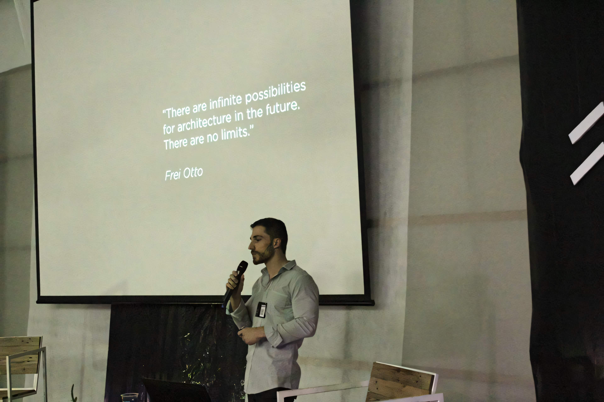
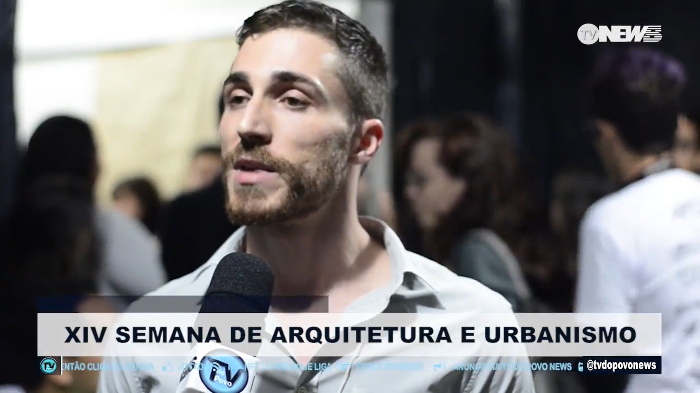

A UNEMAT foi a primeira universidade onde estudei arquitetura. Dez anos depois de começar a estudar lá, apresentei esta palestra sobre a minha trajetória: a transferência para a FAU-USP, o trabalho no Atelier Marko Brajovic e a recente mudança de carreira, com foco em design computacional e programação. A palestra, intitulada "Arquitetura + Biomimética + Algoritmo", foi estruturada em três partes.

## Parte 1: Trajetória acadêmica

A primeira parte abordou a trajetória acadêmica após deixar a UNEMAT, começando pela transferência para a FAU-USP em São Paulo. Lá, convivi com o icônico edifício de Vilanova Artigas e suas famosas goteiras, o laboratório LAME, professores inspiradores e um forte viés social na arquitetura, embora a área de tecnologia ainda fosse limitada.

Pelo programa Ciência sem Fronteiras, passei um período na Auburn University no Alabama, onde o Rural Studio me deu experiência prática na construção de projetos para comunidades carentes, unindo trabalho de campo rigoroso a impacto real. Em seguida, fiz um estágio na California State University, Long Beach (CSULB), onde o fluxo de trabalho era dinâmico, as exigências técnicas rigorosas e os ajustes aconteciam quase em tempo real. Ficar fluente em inglês foi um divisor de águas e um investimento de longo prazo.

## Parte 2: Atelier Marko Brajovic

A segunda parte apresentou o trabalho no Atelier Marko Brajovic, um escritório de arquitetura em São Paulo que tem a biomimética no centro do seu trabalho. Os projetos apresentados incluíram o Ekoa Park (com desenhos executivos, cortes e estudos de insolação), o estande da Docol na Exporevestir, o pavilhão Parada Coca-Cola, estruturas de tensegrity e a instalação Nike Air Max.

## Parte 3: Pesquisa e Grasshopper

Na parte final, mostrei pesquisas independentes e explorações em design computacional com o Grasshopper, com diversas técnicas algorítmicas: Attractor, Circle Packing, Delaunay, Differential Growth, Dual Mesh, Exoskeleton, Fractal, Gradient Descent, Hexagon, Inflatable, L-system, Metaball, Minimal Path Networks, Multi-Agent Interactions, Origami, Phyllotaxis, Relaxation, Reciprocal, Relative Neighborhood, Substrate, Tensegrity, Twisted Tower, Voronoi, Zonohedral Dome, Waffle, e análise ambiental com Honeybee e Ladybug.

