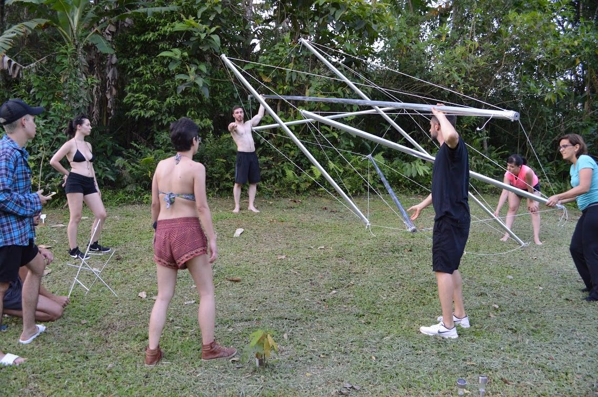
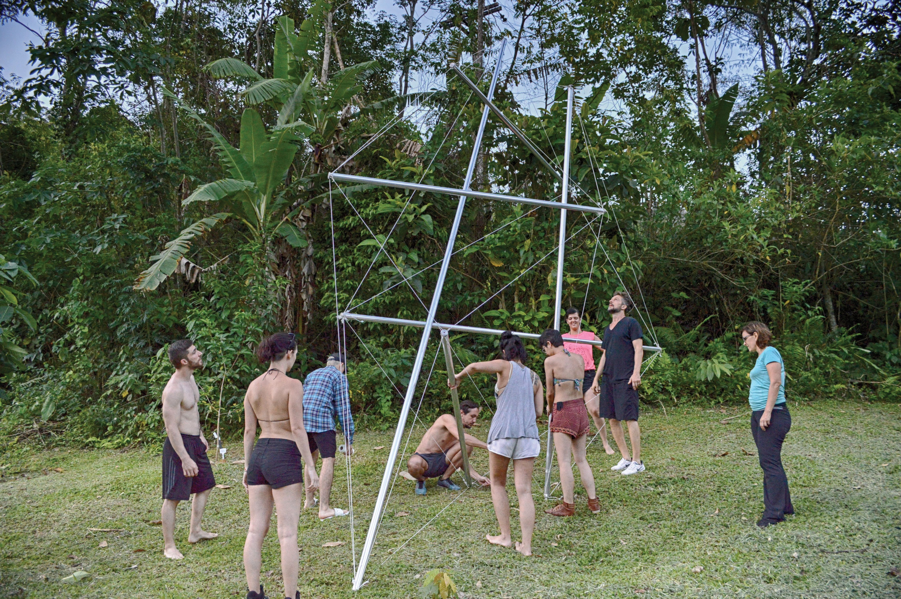
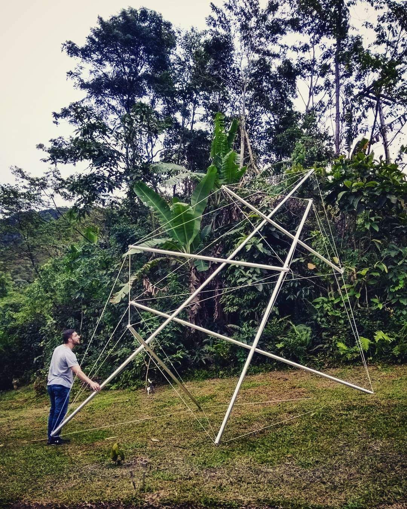
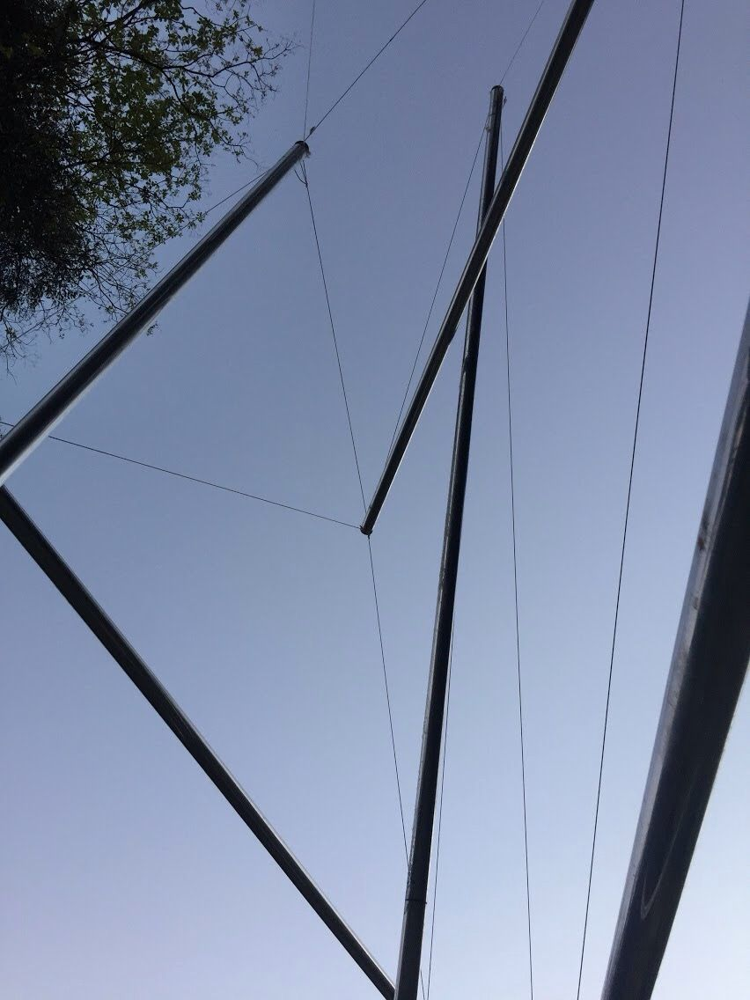

import Figure from '@/components/Figure.astro'

Nós, da equipe do Atelier Marko Brajovic, nos reunimos em Paraty para construir juntos uma estrutura de tensegridade e fortalecer nossos laços ao longo do processo.

## O que é uma tensegridade?

Uma tensegridade (abreviação de "integridade tensional") é um sistema estrutural em que barras rígidas flutuam numa rede contínua de cabos tracionados. Nenhuma barra toca a outra; a estrutura mantém sua forma inteiramente pelo equilíbrio de forças, conceito popularizado por Buckminster Fuller e Kenneth Snelson.

## A construção

Usando tubos metálicos para compressão e cabos para tração, montamos a estrutura ao ar livre. Cada pessoa segurava uma barra ou puxava um cabo enquanto o sistema gradualmente encontrava seu equilíbrio. A estrutura simplesmente não ficava de pé sem a participação de todos ao mesmo tempo; se uma pessoa soltasse, tudo caía.

<Figure credit="Adalberto de Paula">
  
</Figure>

## O resultado

A estrutura final ficou com mais de três metros de altura, um sistema autoportante de barras flutuantes mantidas juntas puramente por tração. Manter a estrutura em equilíbrio, todos juntos, refletia a forma como colaboramos no ateliê.

